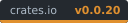
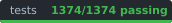
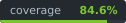

<h1 align="center">baudelaire</h1>

<p align="center">
    
    
    
</p>

<p align="center">
    A static site generator where everything is <a href="https://typst.app">Typst</a>.
    Pages, layouts and data are one language, so a heading, a footnote and a
    nav menu are written the same way.
</p>

<p align="center">
    <b><a href="https://baudelaire.cstef.dev">Documentation</a></b> ·
    <a href="https://github.com/cestef/baudelaire/tree/main/themes">Themes</a> ·
    <a href="https://github.com/cestef/baudelaire/blob/main/CHANGELOG.md">Changelog</a>
</p>

## A page

Content is a `.typ` file. Frontmatter is an ordinary Typst binding, so the
compiler sees it:

```typ
#let frontmatter = (
  title: "Hello",
  date: datetime(year: 2026, month: 7, day: 30),
  tags: ("typst",),
  summary: "The first thing I published.",
)

= A heading

Some *content*, a #link("https://typst.app")[link], and anything else Typst can
set: math, figures, footnotes, tables.
```

Drop that in `content/posts/hello.typ` and it publishes at `/posts/hello/`,
joins the feeds and the sitemap, shows up under `/tags/typst/`, and gets
prev/next links from its neighbors. None of this needs configuration.

Markdown works too. Its frontmatter format follows its fence: `---` is YAML,
`+++` is TOML, `;;;` is KDL. A post copied out of another generator needs no
rewriting.

```md
---
title: Hello
tags: [typst]
---

Ordinary **prose**, and a [link](https://typst.app).
```

A `.md` page lowers to Typst before it compiles, so permalinks, taxonomies,
feeds, link checking and the incremental cache work as above.

The layout that wraps it is Typst too. It builds DOM nodes, not strings:

```typ
#import "@baudelaire/html:0.1.0": h

#let page(page, body) = {
  h("article", {
    h("h1", page.frontmatter.title)
    if page.date != none {
      h("time", datetime: page.date.iso, page.date.display)
    }
    body
  })
}
```

## Install

Prebuilt binaries exist for Linux (x86_64/aarch64), macOS and Windows. Fetch the
install script, read it, run it:

```sh
curl -fsSL https://baudelaire.cstef.dev/install.sh -o install.sh
less install.sh # read it
sh install.sh
```

On Windows, in PowerShell:

```powershell
irm https://baudelaire.cstef.dev/install.ps1 -OutFile install.ps1
notepad install.ps1     # read before you run
.\install.ps1
```

Or with Cargo:

```sh
cargo binstall baudelaire # prebuilt tarball, no compile
cargo install baudelaire  # build from crates.io
```

To build from git:

```sh
cargo install --git https://github.com/cestef/baudelaire --branch main # build from git
```

Flags, slim builds, and what the installer does and does not verify are in
[installation](https://baudelaire.cstef.dev/start/install/).

## Start

```sh
baudelaire init poem
# answer some questions...
cd poem
baudelaire serve
```

The site is at [localhost:1821](http://localhost:1821) and rebuilds when you save.

## Themes

A theme is templates, assets and config defaults in one unit. The repository has
four:

| | |
|---|---|
| [`albatros`](https://github.com/cestef/baudelaire/tree/main/themes/albatros) | A blog. Centered column, light and dark, tags, reading time. |
| [`spleen`](https://github.com/cestef/baudelaire/tree/main/themes/spleen) | A terminal. Monospace throughout, dark first, no JavaScript. |
| [`phares`](https://github.com/cestef/baudelaire/tree/main/themes/phares) | A manual. Sidebar from your content tree, search palette, on-page outline. |
| [`paysage`](https://github.com/cestef/baudelaire/tree/main/themes/paysage) | A portfolio. Landing page, project grid, one case study per project. |

They are inside the binary, so nothing is fetched. `baudelaire init` offers them
with the starter shapes, and an existing project adds one with:

```sh
baudelaire theme add albatros            # one this binary ships
baudelaire theme add gh:owner/repo       # or a directory, archive or package
```

Either way the files land in `themes/albatros/` and the config names the theme:

```kdl
theme "themes/albatros"
```

Everything a theme provides is a default: your file at the same path wins, and
your config wins key by key. Nine sections belong to you, and a theme that sets
one is refused: `paths`, `hooks`, `announce`, `deploy`, `profiles`, `serve`,
`typst`, `security` and `lint`. They control what runs on your machine and what
a browser is told.

## License

Dual-licensed under [MIT](https://github.com/cestef/baudelaire/blob/main/LICENSES/MIT.txt)
or [Apache-2.0](https://github.com/cestef/baudelaire/blob/main/LICENSES/Apache-2.0.txt),
at your option.
